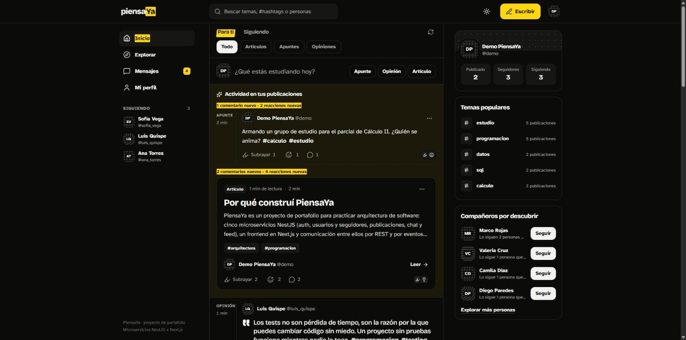
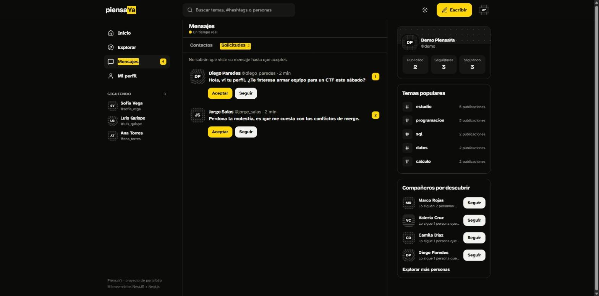
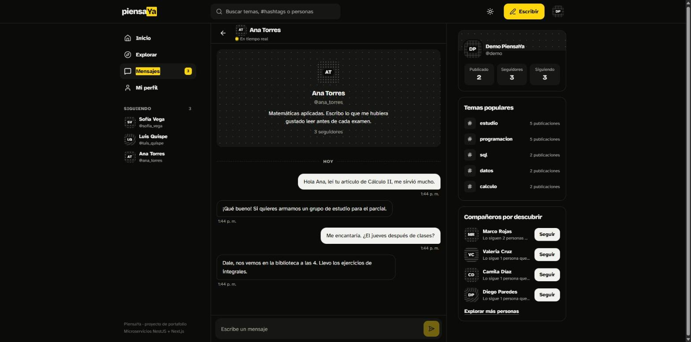
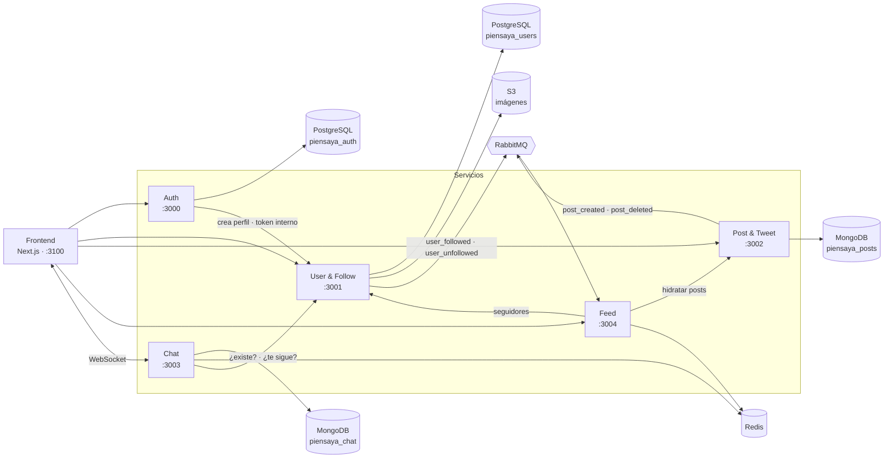

# PiensaYa

[](https://github.com/andresklve/PiensaYa/actions/workflows/ci.yml)

Plataforma social para estudiantes, al estilo **Medium + Twitter**: artículos largos, apuntes cortos y opiniones, con comentarios, reacciones, un feed personalizado y chat privado en tiempo real.

Es un proyecto de portafolio personal para explorar **arquitectura de microservicios** y **diseño de sistemas distribuidos**: comunicación síncrona y asíncrona, consistencia eventual, caché pre-calculada y tiempo real. No tiene fines comerciales ni afiliación institucional.

---

## Contenido

- [Capturas](#capturas)
- [Funcionalidades](#funcionalidades)
- [Arquitectura](#arquitectura)
- [Stack técnico](#stack-técnico)
- [Decisiones de diseño](#decisiones-de-diseño)
- [Cómo correrlo en local](#cómo-correrlo-en-local)
- [Despliegue](#despliegue)
- [Testing y CI](#testing-y-ci)
- [Estructura del repositorio](#estructura-del-repositorio)

---

## Capturas

| Feed «Para ti» | Mensajes: solicitudes | Conversación |
|---|---|---|
|  |  |  |

> Capturas del stack de producción corriendo en local, con los datos de demostración de `scripts/seed.mjs`.

---

## Funcionalidades

**Publicar y conversar**
- Tres formatos: **artículo** (con título), **apunte** (≤ 280 caracteres) y **opinión** (≤ 600 caracteres).
- Comentarios y 6 tipos de reacción. Tu propia reacción se guarda en el servidor y se ve igual en cualquier dispositivo.
- `#hashtags` normalizados (sin importar mayúsculas ni tildes), con autocompletado y páginas por tema.
- Buscador unificado de temas, personas y publicaciones.

**Red social**
- Seguir y dejar de seguir, con perfiles, foto de perfil y portada subidas como archivo (recortadas y convertidas a WebP).
- Sugerencias de "amigos de amigos", ordenadas por cuántas personas en común las siguen.
- Feed **Siguiendo**, pre-calculado con fan-out on write en Redis.
- Feed **Para ti**: 3 publicaciones de gente que sigues por cada 1 de descubrimiento, rankeada por interacción y antigüedad.

**Chat en tiempo real**
- Mensajes 1 a 1 por WebSocket (Socket.IO con adapter de Redis), con historial paginado y confirmación de "Visto".
- Bandeja separada en **Contactos** y **Solicitudes**. Un desconocido puede enviarte hasta 3 mensajes, hasta que lo aceptes, le respondas o lo sigas.
- Contador de conversaciones sin leer, que se actualiza en vivo en toda la app.

**Seguridad**
- JWT con access y refresh token, y roles `USUARIO` / `ADMIN`.
- Endpoints internos entre servicios protegidos con un token de servicio.
- Rate limiting en las rutas sensibles: login, registro, publicar, comentar y enviar mensajes.

---

## Arquitectura

Son cinco **microservicios independientes**. Cada uno es un proyecto NestJS con su propio `package.json`, puerto, configuración y base de datos.



| Servicio | Puerto | Responsabilidad | Almacenamiento |
|---|---|---|---|
| **Auth** | 3000 | Registro y login por username, JWT (access + refresh), roles, cambio de contraseña | PostgreSQL |
| **User & Follow** | 3001 | Perfiles, grafo de seguidores, sugerencias, imágenes de perfil | PostgreSQL + S3 |
| **Post & Tweet** | 3002 | Publicaciones, comentarios, reacciones, hashtags y búsqueda; publica eventos | MongoDB |
| **Chat** | 3003 | Mensajería en tiempo real, historial, no leídos, solicitudes de mensaje | MongoDB + Redis |
| **Feed** | 3004 | Consume eventos y mantiene el feed de cada usuario (fan-out on write) | Redis |

Cada servicio documenta su API con **Swagger** en `/docs`, por ejemplo `http://localhost:3002/docs`.

### Flujo de una publicación

1. El **Post Service** guarda la publicación y emite `post_created` a RabbitMQ.
2. El **Feed Service** consume el evento, pregunta al **User & Follow Service** quiénes siguen al autor y escribe el post en el feed de cada seguidor en Redis.
3. Si el User & Follow Service está caído, el mensaje vuelve a la cola (`nack`) y se reintenta, así la publicación nunca se pierde.
4. Al borrar, `post_deleted` retira el post de todos los feeds y deja una *lápida* en Redis. Así, un `post_created` que se procese después (por concurrencia o reintento) no lo vuelve a insertar.
5. Al seguir a alguien, `user_followed` trae sus publicaciones recientes al feed (backfill). Al dejar de seguir, `user_unfollowed` las purga.

### Autenticación entre servicios

- Los cinco servicios comparten el `JWT_SECRET` y validan el token **localmente** con passport-jwt, sin llamar al Auth Service en cada request.
- El payload es `{ sub, username, role }`.
- Las rutas internas, como la creación de perfil al registrarse, exigen el header `x-internal-token`.

---

## Stack técnico

| Capa | Tecnologías |
|---|---|
| **Backend** | NestJS 11 · TypeScript · Prisma 6 · Mongoose · Passport-JWT · class-validator · Socket.IO · @nestjs/throttler · Swagger |
| **Datos y mensajería** | PostgreSQL 16 · MongoDB 7 · Redis 7 · RabbitMQ 3 · S3 (S3Mock en local) |
| **Frontend** | Next.js 16 (App Router) · React 19 · TanStack Query · Tailwind CSS 4 · Framer Motion |
| **Calidad** | Jest · oxlint · ESLint · tests e2e con `node:test` · GitHub Actions |
| **Infraestructura local** | Docker Compose · pnpm |

---

## Decisiones de diseño

- **Microservicios reales en lugar de un monolito modular.** El objetivo es practicar lo que un monolito esconde: contratos entre servicios, fallos parciales y consistencia eventual.
- **Fan-out on write para el feed.** Leer el feed es una sola consulta a Redis, y el costo se paga al publicar. Cada post guarda un único snapshot compartido por todos los feeds, y los feeds solo guardan IDs.
- **Polyglot persistence.** Se usa PostgreSQL donde hay relaciones e integridad (cuentas, grafo social), MongoDB para documentos con mucha escritura (publicaciones, mensajes) y Redis para datos derivados y tiempo real.
- **Validación local del JWT.** Ningún servicio depende del Auth Service para autenticar una request.
- **Login por username, no por email.** La verificación de correo con proveedores gratuitos requiere un dominio propio, así que se pospuso.
- **Rate limiting selectivo.** Solo se limitan las rutas de escritura sensibles, para no penalizar la navegación normal.

---

## Cómo correrlo en local

### Requisitos

- [Docker](https://www.docker.com/) (Docker Desktop en Mac o Windows)
- [Node.js 24](https://nodejs.org/)
- [pnpm 10](https://pnpm.io/)

### Inicio rápido

```bash
git clone https://github.com/andresklve/PiensaYa.git
cd PiensaYa

# Dependencias de cada servicio y del frontend
for dir in backend/*-service frontend; do (cd "$dir" && pnpm install); done

# Infraestructura + migraciones + los 5 servicios + frontend
./start-all.sh
```

`start-all.sh` hace lo siguiente:

1. Crea los `.env` que falten a partir de los `.env.example`. Esos valores de desarrollo ya funcionan juntos.
2. Levanta PostgreSQL, MongoDB, Redis, RabbitMQ y S3Mock con Docker Compose, y espera sus healthchecks.
3. Aplica las migraciones de Prisma.
4. Compila y arranca los cinco servicios y el frontend. Los logs quedan en `logs/`, y `Ctrl+C` detiene todo.

Cuando termina, queda disponible:

| | URL |
|---|---|
| Aplicación | http://localhost:3100 |
| API docs (Swagger) | http://localhost:3000/docs … http://localhost:3003/docs |
| RabbitMQ Management | http://localhost:15672 (`guest` / `guest`) |

> PostgreSQL se expone en el puerto **5433**, para no chocar con un Postgres instalado en la máquina.

### Datos de demostración

Con los servicios corriendo, carga usuarios, publicaciones, comentarios, reacciones y conversaciones de ejemplo (así la app no se ve vacía):

```bash
node scripts/seed.mjs
```

Después entra con la cuenta **`demo`** / **`Demo12345`**. El script es idempotente y respeta el rate limiting (espera unos dos minutos); si arrancas los servicios con `THROTTLE_DISABLED=true` es inmediato.

### Desarrollo de un solo servicio

Para trabajar con hot-reload en un servicio puntual:

```bash
cd backend/post-service
pnpm start:dev
```

### Variables de entorno

Cada servicio tiene su `.env.example` documentado. Hay tres reglas importantes:

- `JWT_SECRET` debe ser **idéntico** en los cinco servicios.
- `INTERNAL_SERVICE_TOKEN` debe coincidir entre Auth y User & Follow.
- `RABBITMQ_FEED_QUEUE` debe coincidir entre Post, User & Follow y Feed.

`THROTTLE_DISABLED=true` desactiva el rate limiting, lo que sirve para pruebas de carga o e2e.

---

## Despliegue

El repositorio incluye todo lo necesario para publicarlo en **cualquier servidor con Docker** (`deploy/`):

- **Imágenes de producción:** un `Dockerfile` compartido para los cinco servicios (`backend/Dockerfile`, multi-stage, sin root, con migraciones de Prisma al arrancar) y otro para el frontend (Next.js `standalone`).
- **`deploy/docker-compose.prod.yml`:** Caddy con HTTPS automático (Let's Encrypt) + los cinco servicios + frontend + PostgreSQL, MongoDB, Redis, RabbitMQ y almacenamiento S3. Solo se exponen los puertos 80 y 443; las bases de datos quedan en la red interna y todo lleva contraseña.
- **Un solo dominio de API:** Caddy reparte por prefijo de ruta (`/auth`, `/users`, `/posts`, `/chat`, `/feed`) y también el WebSocket del chat.
- **Configuración por entorno:** secretos aleatorios (`deploy/generate-secrets.sh`), CORS restringido al dominio de la app y rate limiting con la IP real detrás del proxy.

```bash
cd deploy
cp .env.example .env && ./generate-secrets.sh >> .env   # y editar los dominios
docker compose -f docker-compose.prod.yml up -d --build
```

Este stack de producción se probó completo en local (12 contenedores sanos y la suite e2e pasando a través de Caddy), y el CI construye todas las imágenes en cada push. Guía paso a paso, respaldos y lista de seguridad en [`deploy/DEPLOY.md`](deploy/DEPLOY.md).

---

## Testing y CI

```bash
# Unitarios (en cada servicio)
cd backend/feed-service && pnpm test

# End-to-end, con todo el stack levantado
node --test "e2e/*.test.mjs"
```

- **101 tests unitarios** entre los cinco servicios, con Jest.
- **Suite e2e** (`e2e/`) que recorre el sistema real sin mocks: registro → perfil creado por token interno → seguir → sugerencias → publicar → RabbitMQ → feed → reacción → borrado → solicitudes de chat con su tope.
- **GitHub Actions** corre en cada push a `main` y en cada pull request:
  - Por servicio: lint → `tsc --noEmit` → build → tests.
  - **e2e**: levanta Docker Compose y los cinco servicios en el runner y ejecuta la suite.
  - **Docker**: construye las imágenes de los cinco servicios y del frontend y valida `docker-compose.prod.yml`.
  - Frontend: lint → type check → `next build`.

---

## Estructura del repositorio

```
PiensaYa/
├── backend/
│   ├── auth-service/          # NestJS + Prisma (PostgreSQL)
│   ├── user-follow-service/   # NestJS + Prisma (PostgreSQL) + S3
│   ├── post-service/          # NestJS + Mongoose (MongoDB) + RabbitMQ
│   ├── chat-service/          # NestJS + Mongoose + Socket.IO + Redis
│   ├── feed-service/          # NestJS + RabbitMQ + Redis
│   ├── docker/                # Init de PostgreSQL
│   ├── docker-compose.yml     # Infraestructura local (desarrollo)
│   └── Dockerfile             # Imagen de producción de cualquier servicio
├── frontend/                  # Next.js 16 + React 19 (+ Dockerfile)
├── deploy/                    # Stack de producción: compose, Caddy y guía
├── e2e/                       # Tests end-to-end entre servicios
├── scripts/seed.mjs           # Datos de demostración
├── docs/screenshots/          # Capturas del README
├── .github/workflows/ci.yml   # Integración continua
└── start-all.sh               # Levanta todo el entorno local
```

---

Desarrollado por **Carlos Andrés Infantas Galindo** ([@andresklve](https://github.com/andresklve)).
